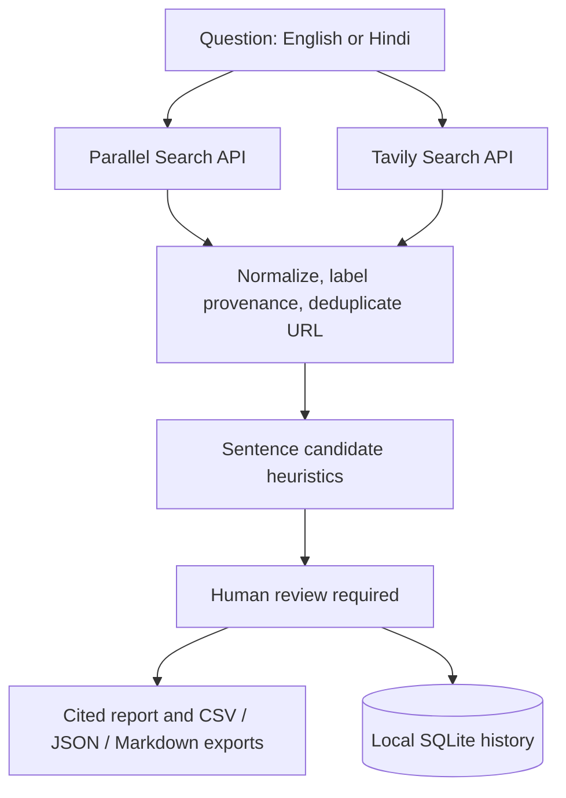

# Project 11 — Evidence Desk

A portfolio-grade Streamlit research lab with independent Parallel Search and Tavily Search adapters. It runs in demo mode without credentials. There is no LLM integration, model endpoint, model API key requirement, document upload, or hidden model call.

## What it does

- Accepts research questions in English or Hindi.
- Calls Parallel and Tavily independently; either provider can be absent or fail while the other continues.
- Uses documented provider response fields to preserve titles, URLs, publication dates when present, snippets, provider provenance, and Tavily raw content when returned.
- Deduplicates canonical URLs while retaining both providers in provenance.
- Creates conservative sentence candidates and labels every one **Needs human review**. It does not infer support or contradiction from snippets.
- Provides cautious domain-hint source labels, inspection, Markdown/JSON/CSV downloads, and local SQLite history.
- Includes bounded timeouts, limited retries for transient/network errors, and explicit HTTP status reporting including rate limits.

## Windows setup

Open PowerShell in the `project11` folder:

```powershell
py -3.11 -m venv .venv
.\.venv\Scripts\Activate.ps1
python -m pip install --upgrade pip
pip install -r requirements.txt
Copy-Item .env.example .env
```

Edit `.env` with `PARALLEL_API_KEY` and/or `TAVILY_API_KEY`. You can use either provider alone. Keep the file private; it is ignored by Git. Run:

```powershell
streamlit run app.py
```

To explore without keys, enable **Demo mode** in the sidebar. The demo uses fixed local sample data and makes no API calls.

## Configuration

| Variable | Required | Purpose |
|---|---:|---|
| `PARALLEL_API_KEY` | No | Authenticates Parallel Search using `x-api-key`. |
| `TAVILY_API_KEY` | No | Authenticates Tavily Search with Bearer token. |

The Parallel adapter uses `POST https://api.parallel.ai/v1/search`; Tavily uses `POST https://api.tavily.com/search`. The app does not call model APIs.

## Tests

```powershell
pytest -q
```

Tests mock provider HTTP responses, verify auth/request shapes, exercise deduplication and provenance, check cautious claims, and use temporary SQLite storage. No live provider key is required.

## Architecture



## Azure deployment guidance

The app has no Azure-specific runtime dependency. For an Azure App Service or Container Apps deployment, package this folder with a Python 3.11 runtime, install `requirements.txt`, set the startup command to `streamlit run app.py --server.address 0.0.0.0 --server.port 8000`, and configure `PARALLEL_API_KEY` and `TAVILY_API_KEY` as app settings or Key Vault references. Do not bake secrets into the image or repository. Add authentication in front of the Streamlit app, restrict outbound traffic to the providers you use, and persist/backup the `data/` directory if run history must survive restarts. A local SQLite file is suitable for a single-instance demo, not a multi-replica production database; use Azure Database for PostgreSQL or another managed database before scaling horizontally. Confirm current Azure runtime, pricing, and security settings for your subscription before deployment.

## Privacy, provenance, and limitations

When live search runs, the question is sent to configured search providers. Returned search results are saved to local SQLite history. API keys are never stored in report rows or exports. This MVP does not accept or upload user documents. Consider retention and access controls before sharing or deploying the app.

Two providers do not guarantee independent confirmation: they may return the same publisher or syndicated text. URL deduplication cannot reliably detect copies at different URLs. Domain hints are not source verification or credibility scores. Sentence splitting is not semantic claim extraction. Search coverage, dates, and extracted content are provider-dependent. Human review of the cited source is required for conclusions.

## Official API contracts

- [Parallel Search API Quickstart](https://docs.parallel.ai/search/search-quickstart) and [advanced settings](https://docs.parallel.ai/search/advanced-search-settings) — current `/v1/search`, `x-api-key`, `objective`, `advanced_settings.max_results`, and `results[].excerpts` contract.
- [Tavily Search API Reference](https://docs.tavily.com/documentation/api-reference/endpoint/search) — `/search`, Bearer authentication, `max_results`, `include_raw_content`, and `results[]` fields.
